<div align="center">

# 🔮 Guesser for Flipper Zero

**Think of anything — your Flipper asks a few questions and guesses it.**
Animals, food, things in your home, famous people, cartoon and game
characters, brands, apps, films, football clubs, places and more:
**5,514 things** and **716 questions**, fully **offline** on the Flipper.


[](https://github.com/King-Kong-341/Flipper-Zero-Games_Guesser/actions/workflows/build.yml)

 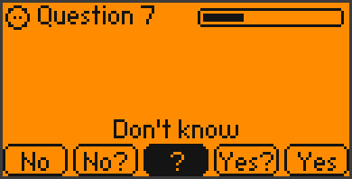

</div>

---

## 📁 What's in here?

| Folder | What it is | Who needs it |
|---|---|---|
| 📦 **[`Guesser/`](Guesser/)** | the finished app: **`guesser.fap`** (the knowledge base is inside) | everyone — this is the file for your Flipper |
| 🧩 [`source/`](source/) | the C source code and the knowledge base | only if you want to build or change the app |
| 🖼 [`images/`](images/) | the pictures on this page | — |

## 🎯 What is this?

You think of something. Guesser — a little crystal ball with eyes — asks
yes/no questions, and every question is picked fresh from your answers so
far, so it quickly closes in: *Is it made by people? → Would you find it in a
house? → Is it furniture? → Do you sit on it?* Then it names it. Wrong? It
asks a few more and tries again — three guesses in total. Still wrong? Teach
it your thing and it knows it next time.

It stays on topic: once it is clear you mean a piece of furniture, it will not
ask whether it is male or female.

 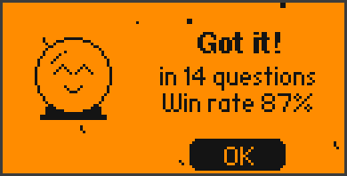

### What it knows

| | |
|---|---|
| 🐾 **752 animals** | pets, dog and cat breeds, farm and wild animals, birds, fish, sea life, insects, reptiles, dinosaurs |
| 🍕 **883 foods and plants** | fruit, vegetables, dishes from all over the world, sweets, drinks, trees, flowers, houseplants |
| 🏠 **1,685 things** | everything around the house and on the street, tools, electronics, vehicles, clothes, toys, sports gear, instruments, buildings |
| 🦸 **2,194 others** | famous people, jobs, cartoon, film, book and game characters, myths, brands, apps, films, TV shows, video games, football clubs, countries, cities, nature, space, body parts, feelings, events |

## 📥 Installation

1. Open the folder **[`Guesser`](Guesser/)** and click
   **`guesser.fap`** → **Download** (the ⬇ button on the right).
   It's also on the [Releases page](https://github.com/King-Kong-341/Flipper-Zero-Games_Guesser/releases).
2. Open [qFlipper](https://flipperzero.one/update) on your computer and
   connect your Flipper via USB.
3. In qFlipper's **File Manager**, copy the file to **`SD Card/apps/Games/`**.
4. On the Flipper: **Menu → Apps → Games → Guesser**. Have fun!

> **qFlipper says "Cannot connect to the update server"?** That is only its
> online firmware check and has nothing to do with the app — close the message
> and use the **File Manager** tab (not "Install from file", which is for
> firmware). Copying the 4 MB file takes about a minute. No qFlipper at hand?
> Put the SD card in a card reader and copy the file to `apps/Games/`.

> The first start takes a few seconds longer: the Flipper unpacks the 4 MB
> knowledge base and checks it once. Built for the **official firmware 1.5** (API 88). On older firmware, update your Flipper first.

## 🎮 How to play

| Key | Action |
|---|---|
| ◀ ▶ | pick an answer: **No · No? · ? · Yes? · Yes** (the full meaning is shown above the buttons) |
| **OK** | confirm |
| ▲ / ▼ | shortcut for **Yes** / **No** |
| **Back** | undo your last answer |
| hold **Back** | give up |

Not sure? **No?** means *probably not*, **Yes?** means *probably*, **?** means
*don't know* — Guesser copes with honest uncertainty.

## 📸 Screens

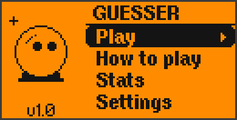 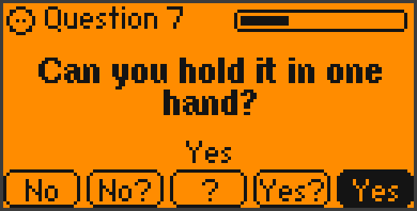 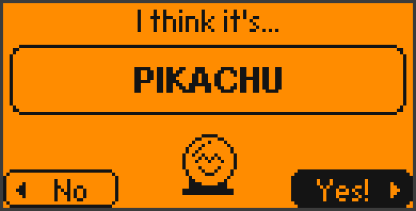
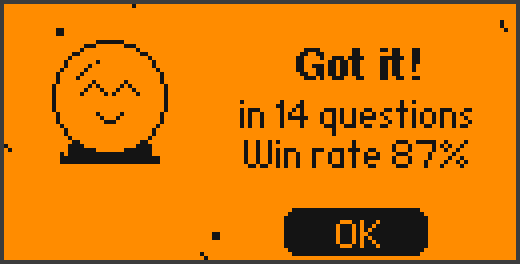 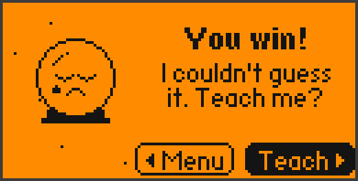 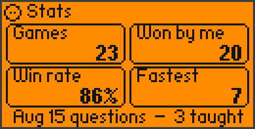
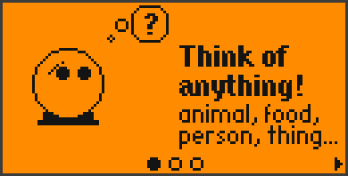 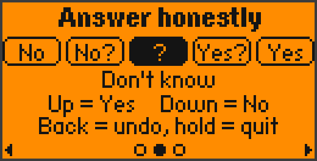 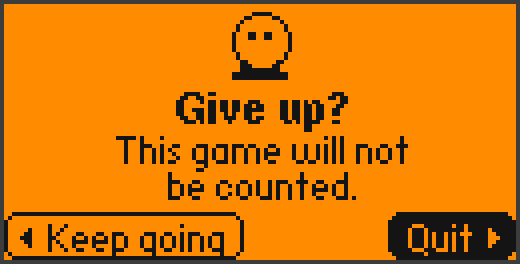

## ✨ Features

- 🔮 **Animated mascot** that blinks, looks around while thinking, lights up
  when it guesses, celebrates with confetti and sheds a tear when it loses
- 🎬 Intro with loading animation, sliding menu highlight, questions that
  glide in, a dramatic guess reveal
- 🧠 **Smart questions:** after every answer it scores all 716 questions
  against its front-runners and asks the one that tells it the most —
  and skips questions that make no sense for what you are thinking of
- 📚 **Teach it:** things it could not guess are remembered on your Flipper
- 📊 Stats (games, wins, fastest win), settings (number of questions, sound,
  vibration), a three-page "How to play"
- 📴 **Fully offline:** the whole knowledge base lives on the SD card and is
  read in small pieces — it is never loaded into RAM

## 🛠 Build it yourself

```bash
cd source
python knowledge/build_kb.py      # knowledge base -> files/guesser.dat
python -m ufbt                    # builds dist/guesser.fap
```

The knowledge base is plain text in [`source/knowledge/kb/`](source/knowledge/kb/).

## 📜 Credits

Based on [20 Questions](https://github.com/Cheesedog223/20Q_Flipper0) by
**Cheesedog223** (MIT): the Bayesian engine and the data-file idea come from
there. Guesser adds the new knowledge base, the information-gain question
picking with topic awareness, the new animated interface and everything else.
